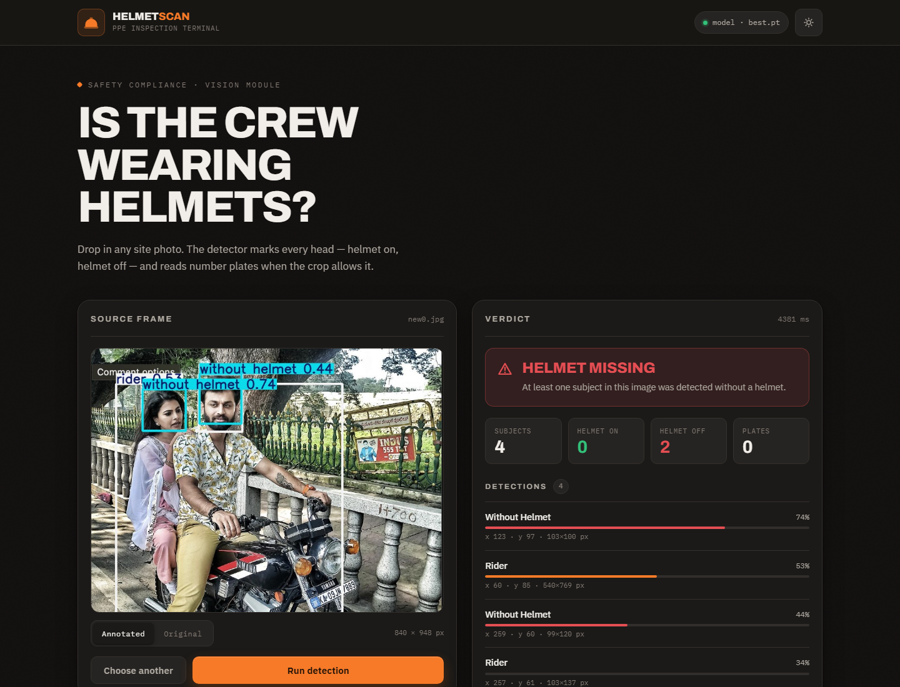

# Helmet Detection

A small Flask app for instant helmet compliance checks. Drop a site photo into the UI and get a verdict (`Helmet detected` / `Helmet missing` / `undetermined`) with per-object detections, confidence bars, and optional number-plate reads.



## Quick start

```bash
pip install -r requirements.txt
python app.py
```

Open http://127.0.0.1:8000 and upload an image. The trained YOLOv8 weights are included in this repo (`weights/best.pt`), so detection works on a fresh clone with no training step.

If `weights/best.pt` is missing, the app falls back to stock COCO `yolov8n.pt` and shows a notice that helmet classes are unavailable.

## Classes

The model is fine-tuned for four labels:

| Class | Meaning |
| --- | --- |
| `with helmet` | Head with a helmet on |
| `without helmet` | Head without a helmet |
| `rider` | Person on a two-wheeler |
| `number plate` | Plate region, read with EasyOCR when installed |

## Model

- Checkpoint: `weights/best.pt` (YOLOv8n, ~6 MB, committed).
- Trained on 104 images with 20 held out for validation.
- Confidence threshold defaults to `0.25` (`HELMET_CONF`).
- Validation numbers on 20 images are not a production benchmark. Re-evaluate on real footage before relying on the verdict.

The dataset itself is **not** committed (75 MB). To retrain, put a dataset at `archive/` with `archive/coco128.yaml` and run:

```bash
python helmet_detection.py train --data "archive/coco128.yaml" --force
```

## API

- `GET /` — HTML frontend
- `GET /api/health` — model/dataset status
- `POST /api/detect` — `multipart/form-data` with field `image` (or `file`). Returns `{ ok: true, verdict, verdict_label, summary, detections[], plates[], annotated_image: "data:..." }`

```bash
curl -X POST -F "image=@photo.jpg" http://127.0.0.1:8000/api/detect
```

## CLI

```bash
python helmet_detection.py train   --data path/to/coco128.yaml [--force]
python helmet_detection.py predict --image photo.jpg --save out.jpg --json
python helmet_detection.py serve   --host 127.0.0.1 --port 8000
```

## Environment variables

| Variable | Default | Notes |
| --- | --- | --- |
| `HELMET_WEIGHTS` | `weights/best.pt` | Path to the weights file to load. |
| `HELMET_DATA` | `archive/coco128.yaml` | Used by `train`. |
| `HELMET_BASE_WEIGHTS` | `yolov8n.pt` | Stock weights used if no trained weights exist. |
| `HELMET_AUTO_TRAIN` | `true` | Auto-train if the dataset exists and no weights are found. Set `false` for serving. |
| `HELMET_CONF` / `HELMET_IOU` | `0.25` / `0.45` | Inference thresholds. |
| `HELMET_IMGSZ` | `640` | Inference image size. Lower is faster on CPU. |
| `HELMET_OCR` | `true` | Set to `false` to skip EasyOCR (faster first plate read). |
| `HELMET_MAX_UPLOAD_MB` | `12` | Upload limit for the API. |
| `HELMET_PORT` / `HELMET_HOST` | `8000` / `127.0.0.1` | App bind settings. |

## Notes

- `helmet_detection.py` is import-safe: importing it never trains, never downloads data, and never opens a CV window.
- The model loads once and is cached in-process, so uploads never retrain or reload weights.
- EasyOCR is optional. Without it, number plates are detected but not read.
- This is a demo-grade project, not a production service. See the discussion of serving, concurrency, and upload hardening before deploying it publicly.

## License

MIT. See [LICENSE](LICENSE).
